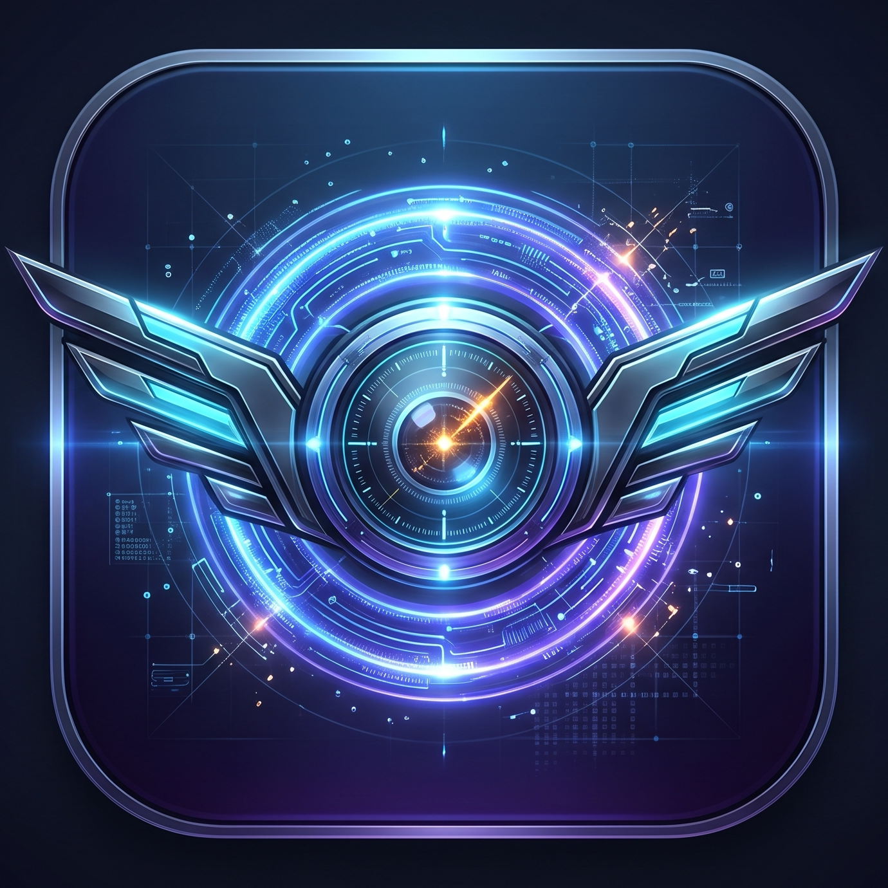

# OmniPilot — Universal Android Cross-App AI Copilot, Live Google Search & Period Attendance Engine

<p align="center">
  
</p>

<p align="center">
  <b>Universal Android Cross-App AI Controller · Gemini 2.0 + Live Google Search Grounding · Complex Period Attendance & Compliance Engine · Floating AI Overlay HUD</b>
</p>

<p align="center">
  <a href="LICENSE"></a>
  <a href="COPYRIGHT.md"></a>
  <a href="SECURITY.md"></a>
  
  
  
</p>

---

> **🔒 Intellectual Property & Anti-Republishing Notice (Quantum Forge Security Standard)**  
> **OmniPilot** is created and owned by **Ali Asghar** ([aliasgharinnocent@yahoo.com](mailto:aliasgharinnocent@yahoo.com)).  
> Every screen in the application embeds a non-intrusive floating copyright watermark (`OmniPilot © Ali Asghar · aliasgharinnocent@yahoo.com · All Rights Reserved · DMCA Protected`), verified at startup by [`OwnershipGuard`](lib/core/security/ownership_guard.dart) and locked against unauthorized Play Store / release bundling in [`android/app/build.gradle.kts`](android/app/build.gradle.kts). Unauthorized removal of copyright watermarks or store redistribution is a violation of **17 U.S.C. § 1202 (DMCA)**. See [COPYRIGHT.md](COPYRIGHT.md) and [SECURITY.md](SECURITY.md).

---

## 🌟 Overview

**OmniPilot** is a wide-purpose Android AI Copilot and Cross-App Automation Assistant built with **Flutter**, **Native Kotlin (`AccessibilityService` + `WindowManager` Floating Overlay)**, **Firebase AI Logic (`gemini-2.0-flash`)**, **Live Google Search Grounding**, and **Cloud Firestore**.

Unlike standard chatbots confined to their own window, **OmniPilot** operates across the entire Android operating system:
1. **🌐 Live Google Search & Multi-Source Web Knowledge Engine**: Answers any general knowledge, science, technology, history, coding, or current events query using Gemini `Tool.googleSearch()` Grounding combined with parallel HTTP retrieval from **Google News RSS**, **Wikipedia REST API**, and **DuckDuckGo Instant Answer API**.
2. **📝 Google Research → Direct External App Writing**: Researches any topic on Google and automatically creates and writes structured, source-cited notes directly into third-party Android apps (such as **Fossify Notes**, **Google Keep**, **Google Docs**, or **Contacts**).
3. **📋 Complex Period Attendance & Compliance Form**: A comprehensive multi-week / semester attendance evaluation form featuring **Dropdowns**, **Date Range Pickers**, **Period Counts**, **Radio Button Groups**, **Compliance Checkboxes**, **Participation Slider**, **Faculty Advisor Sign-Off Switch**, and **Cloud Firestore Sync**—all controllable via natural-language AI prompts.
4. **🤖 Universal Cross-App Accessibility & Floating Overlay HUD**: A draggable floating AI bubble (`SYSTEM_ALERT_WINDOW`) stays over any open Android app, allowing one-tap screen inspection, write verification (`checkExistingWrites`), form autofill (`ACTION_SET_TEXT`), and UI clicking/scrolling (`ACTION_CLICK` / `ACTION_SCROLL_FORWARD`).

---

## 🏗️ Modular Multi-File Architecture (Reusable & Barrel-Exported)

OmniPilot is engineered with a clean, single-responsibility multi-file architecture where **every widget, model, tool declaration, prompt parser, theme, constant, and security guard resides in its own dedicated file** and is re-exported through barrel files (`export`) for effortless reuse:

```text
lib/
├── main.dart                                      # App entry point, OwnershipGuard check & Watermark builder
├── omnipilot.dart                                 # Top-level barrel export for the entire OmniPilot library
├── firebase_options.dart                          # FlutterFire platform configuration
│
├── core/
│   ├── core.dart                                  # Barrel export for all core modules
│   ├── constants/
│   │   ├── app_constants.dart                     # Global constants, author metadata & dropdown/radio options
│   │   └── constants.dart                         # Constants barrel export
│   ├── security/
│   │   ├── ownership_guard.dart                   # Cryptographic authorship & DMCA watermark integrity guard
│   │   └── security.dart                          # Security barrel export
│   ├── theme/
│   │   ├── app_theme.dart                         # Material 3 Light & Dark ThemeData builders
│   │   └── theme.dart                             # Theme barrel export
│   └── widgets/
│       ├── app_brand_icon.dart                    # Reusable rounded OmniPilot artwork widget
│       ├── floating_copyright_watermark.dart      # Global IgnorePointer DMCA copyright watermark
│       ├── section_header_label.dart              # Reusable numbered form section header widget
│       ├── status_badge_chip.dart                 # Reusable color-coded standing/status pill badge
│       └── widgets.dart                           # Core widgets barrel export
│
├── models/
│   ├── models.dart                                # Barrel export for all data models
│   ├── chat_message_model.dart                    # Chat message model for the Assistant console
│   ├── external_field_model.dart                  # Accessibility-inspected external input field model
│   ├── period_attendance_model.dart               # Period attendance evaluation model + percentage calculators
│   └── web_search_result_model.dart               # Grounded Google/Web search result model & formatters
│
├── services/
│   ├── services.dart                              # Barrel export for all services
│   ├── accessibility_bridge.dart                  # Flutter <-> Android MethodChannel bridge
│   └── web_knowledge_service.dart                 # Gemini Google Search Grounding + Wikipedia/News/DDG engine
│
├── assistant/
│   ├── assistant.dart                             # Barrel export for the AI Assistant layer
│   ├── assistant_controller.dart                  # Gemini 2.0 multi-turn function-calling orchestrator
│   ├── assistant_tools.dart                       # Backward-compatible barrel export for tools
│   ├── parsers/
│   │   ├── period_attendance_prompt_parser.dart   # Natural-language parser for complex period attendance forms
│   │   └── parsers.dart                           # Parsers barrel export
│   └── tools/
│       ├── tools.dart                             # Barrel export + bundled `assistantTools` list (13 tools)
│       ├── fill_form_tool.dart                    # Tool 1: autofillScreenFields
│       ├── write_firestore_tool.dart              # Tool 2: saveAttendanceRecord
│       ├── inspect_external_app_tool.dart         # Tool 3: inspectExternalAppScreen
│       ├── check_existing_writes_tool.dart        # Tool 4: checkExistingWrites
│       ├── fill_external_app_tool.dart            # Tool 5: fillExternalAppFields
│       ├── click_external_element_tool.dart       # Tool 6: clickExternalAppElement
│       ├── toggle_external_checkable_tool.dart    # Tool 7: toggleExternalCheckable
│       ├── scroll_external_app_tool.dart          # Tool 8: scrollExternalAppScreen
│       ├── system_navigation_tool.dart            # Tool 9: navigateAndroidSystem
│       ├── launch_external_app_tool.dart          # Tool 10: openExternalAndroidApp
│       ├── write_external_note_tool.dart          # Tool 11: writeNoteInExternalApp
│       ├── search_google_and_web_tool.dart        # Tool 12: searchGoogleAndWeb
│       └── research_and_write_tool.dart           # Tool 13: researchAndWriteToExternalApp
│
└── features/
    └── attendance/
        ├── attendance.dart                        # Feature barrel export
        ├── attendance_screen.dart                 # Main responsive desktop/mobile screen coordinator
        └── widgets/
            ├── widgets.dart                       # Barrel export for all 21 feature widgets
            ├── omni_pilot_app_bar.dart            # Branded AppBar with permission refresh & TabBar
            ├── live_attendance_summary_banner.dart# Real-time effective/raw percentage & standing progress bar
            ├── ai_scenario_presets_bar.dart       # One-tap AI autofill scenario chips
            ├── period_cohort_dropdowns_section.dart # Period Type, Department & Section dropdowns
            ├── period_date_range_section.dart     # Start Date, End Date & Working Days inputs
            ├── student_identity_counts_section.dart # Student Name, Roll No, Present, Leave, Absent & Late fields
            ├── attendance_standing_radio_section.dart # Radio group for Attendance Standing
            ├── attendance_trend_radio_section.dart  # Horizontal radio group for Attendance Trend
            ├── compliance_checkboxes_section.dart # 4 Compliance & Documentation checkboxes
            ├── participation_slider_section.dart  # Class Participation & Punctuality slider
            ├── advisor_signoff_switch_tile.dart   # Faculty Advisor verification lock switch
            ├── advisor_remarks_field.dart         # Multiline advisor remarks & Save button
            ├── period_attendance_form_card.dart   # Composed Period Attendance & Compliance Card
            ├── period_record_list_tile.dart       # Individual saved period attendance record tile
            ├── saved_period_records_card.dart     # Local + Cloud Firestore real-time records card
            ├── permission_status_tile.dart        # Reusable permission status row
            ├── cross_app_controller_card.dart     # Universal Cross-App Controller & Floating Bubble card
            ├── discovered_fields_card.dart        # Inspected external fields, buttons & screen texts card
            ├── prompt_suggestions_bar.dart        # Quick-action prompt chips bar
            ├── chat_message_bubble.dart           # User & AI chat message bubble widget
            └── assistant_chat_console.dart        # Full AI Assistant chat console widget
```

---

## 🛠️ 13 Native AI Tools Powered by Gemini 2.0

| # | Tool Name | File | Capability |
|---|-----------|------|------------|
| 1 | `autofillScreenFields` | [`fill_form_tool.dart`](lib/assistant/tools/fill_form_tool.dart) | Populates Dropdowns, Radio Buttons, Checkboxes, Switch, Slider, Date Range & Period Counts |
| 2 | `saveAttendanceRecord` | [`write_firestore_tool.dart`](lib/assistant/tools/write_firestore_tool.dart) | Persists period attendance records to Cloud Firestore (`attendance_logs`) |
| 3 | `inspectExternalAppScreen` | [`inspect_external_app_tool.dart`](lib/assistant/tools/inspect_external_app_tool.dart) | Scans the foreground Android app's view tree for inputs, buttons, and text |
| 4 | `checkExistingWrites` | [`check_existing_writes_tool.dart`](lib/assistant/tools/check_existing_writes_tool.dart) | Reads and verifies current text values inside external app input fields |
| 5 | `fillExternalAppFields` | [`fill_external_app_tool.dart`](lib/assistant/tools/fill_external_app_tool.dart) | Injects text into external apps via `ACTION_SET_TEXT` and verifies writes |
| 6 | `clickExternalAppElement` | [`click_external_element_tool.dart`](lib/assistant/tools/click_external_element_tool.dart) | Taps or long-presses buttons, dropdown items, or radio options in external apps |
| 7 | `toggleExternalCheckable` | [`toggle_external_checkable_tool.dart`](lib/assistant/tools/toggle_external_checkable_tool.dart) | Toggles checkboxes, switches, or radio buttons in external apps |
| 8 | `scrollExternalAppScreen` | [`scroll_external_app_tool.dart`](lib/assistant/tools/scroll_external_app_tool.dart) | Scrolls external app viewports (`up`, `down`, `left`, `right`) |
| 9 | `navigateAndroidSystem` | [`system_navigation_tool.dart`](lib/assistant/tools/system_navigation_tool.dart) | Executes global Android navigation (`BACK`, `HOME`, `RECENTS`, `NOTIFICATIONS`) |
| 10 | `openExternalAndroidApp` | [`launch_external_app_tool.dart`](lib/assistant/tools/launch_external_app_tool.dart) | Launches any installed Android app by display name or package ID |
| 11 | `writeNoteInExternalApp` | [`write_external_note_tool.dart`](lib/assistant/tools/write_external_note_tool.dart) | Creates titled notes and writes multi-line bodies in external note apps |
| 12 | `searchGoogleAndWeb` | [`search_google_and_web_tool.dart`](lib/assistant/tools/search_google_and_web_tool.dart) | Searches Google, Google News RSS, Wikipedia, and DuckDuckGo |
| 13 | `researchAndWriteToExternalApp` | [`research_and_write_tool.dart`](lib/assistant/tools/research_and_write_tool.dart) | Researches a topic on Google and writes a formatted, cited note into the active app |

---

## 🚀 Getting Started

### Prerequisites
- **Flutter SDK**: `>=3.11.0`
- **Android SDK**: API 24+ (Android 7.0+) with an Android Emulator or physical device
- **Java / Kotlin**: JDK 17

### Installation & Running (Debug Mode)

```bash
# 1. Clone the repository
git clone https://github.com/aliasghar08/OmniPilot.git
cd OmniPilot

# 2. Install Dart/Flutter dependencies
flutter pub get

# 3. Run static analysis & unit/widget verification tests
flutter analyze
flutter test

# 4. Run on a connected Android device or emulator
flutter run
```

### Enabling Cross-App Control on Android
1. Open **OmniPilot** and go to the **Cross-App AI** tab.
2. Tap **Enable** next to **Android Accessibility Service** and toggle on **OmniPilot** in Android Settings → Accessibility.
3. Toggle on **Interactive Floating AI Overlay** and grant the **Display over other apps** permission.
4. Open any third-party app (e.g., **Fossify Notes**, **Contacts**, **Chrome**) and tap the floating **OmniPilot** icon bubble to launch the AI HUD!

---

## 🛡️ Security, Copyright & License

- **Owner:** Ali Asghar ([aliasgharinnocent@yahoo.com](mailto:aliasgharinnocent@yahoo.com))
- **License:** [MIT License with Proprietary Brand, Store Publishing & DMCA Protection Addendum](LICENSE)
- **Copyright Policy:** [COPYRIGHT.md](COPYRIGHT.md)
- **Security Policy:** [SECURITY.md](SECURITY.md)

---

<p align="center">
  <b>OmniPilot © 2026 Ali Asghar · aliasgharinnocent@yahoo.com · All Rights Reserved · DMCA Protected</b>
</p>
